# Лабораторная работа №8

## Проектирование и верстка мобильного и веб-клиента

**Курс:** «Проектирование человеко-машинных интерфейсов»  
**Проект:** PCHelper — интернет-магазин компьютерных комплектующих  
**Команда:** StudentsTrio — Наркевич А. С. (тимлид), Бирюк И. А., Бельский Т. Д.  
**Репозиторий:** https://github.com/AlekseiNarkevich/pchelper-store  
**Ветка разработки:** `develop` (main защищена, финальный PR)  
**Дата:** ноябрь 2026

---

## 1. Цель и задачи

Цель работы — завершить серверное приложение и разработать клиентские программные средства с адаптивной версткой, интегрировать их с API и MCP, обеспечить доступность и качество интерфейса.

Решаемые задачи:

1. Завершить backend: аутентификация, сессии, валидация, серверная корзина и заказы.
2. Реализовать адаптивный веб-интерфейс для разрешений 320–1920 px.
3. Развить мобильный клиент в виде PWA на базе HTML5/CSS3/JavaScript.
4. Подключить MCP-сервер к базе данных проекта.
5. Обеспечить доступность: Lighthouse, W3C, контраст, клавиатура, focus-visible.
6. Настроить CI/CD и подготовить отчёт с вкладом каждого участника.

---

## 2. Распределение работ

| Участник | Зона ответственности | Результат |
|---|---|---|
| Наркевич А. С. | backend, БД, API, MCP, интеграция | JWT/сессии, серверная корзина и заказы, синхронизация MCP с Supabase |
| Бирюк И. А. | веб-клиент, доступность | вход/регистрация, защищённый профиль, адаптив, Lighthouse 100/100/100 |
| Бельский Т. Д. | мобильный клиент, PWA, CI/CD | manifest, service worker, иконки из логотипа, favicon.ico, a11y-правки |

### 2.1. Коммиты в ветке `develop`

| Хеш | Автор | Изменение |
|---|---|---|
| `48806c7` | Бирюк И. А. | план ЛР8 и решения по стеку |
| `a59b52d` | Наркевич А. С. | JWT-аутентификация и тесты |
| `dfdcd98` | Бельский Т. Д. | PWA: manifest, service worker, иконки |
| `5e1d0cd` | Бирюк И. А. | веб-вход, регистрация, `/profile` |
| `9259acc` | Наркевич А. С. | MCP: синхронизация каталога из Supabase |
| `f1406d6` | Наркевич А. С. | серверная корзина и заказы |
| `5290580` | Наркевич А. С. | числовые id пользователей для Supabase |
| `618192d` | Бельский Т. Д. | Lighthouse 100/100, контраст и семантика |

Авторство указывается через `--author`, потому что работа с GitHub идёт с одного компьютера.

---

## 3. Архитектура клиентской части

```
Browser / PWA
   ├── React SPA (веб-витрина)
   │     ├── public pages: главная, каталог, карточка, сборки, корзина
   │     ├── auth pages: /login, /register, /profile
   │     └── api.js, auth.js, cart.js
   └── mobile.html (PWA)
         ├── главная, каталог, поиск, карточка, сборки, корзина
         └── общий API /api/v1 и общий ключ корзины
              │
              ▼
Express API /api/v1
   ├── /categories, /products, /products/:id, /prebuilt  (ЛР7)
   ├── /auth/*                                            (ЛР8)
   ├── /cart, /orders                                     (ЛР8)
   └── /admin/*                                           (ЛР4)
              │
              ▼
Supabase PostgreSQL / Storage  +  MCP-сервер
```

Клиенты не обращаются к Supabase напрямую. Все данные приходят через Express API, который при наличии `SUPABASE_URL` и серверного ключа читает реальную базу. В CI, где ключей нет, используется демонстрационный снимок каталога.

---

## 4. Серверная часть

### 4.1. Аутентификация

Реализованы маршруты:

- `POST /api/v1/auth/register` — регистрация;
- `POST /api/v1/auth/login` — вход;
- `POST /api/v1/auth/refresh` — обновление токенов;
- `POST /api/v1/auth/logout` — выход;
- `GET /api/v1/auth/me` — профиль.

Используются JWT access-токен (15 минут) и refresh-токен (7 дней). Пароли хэшируются через `scrypt` с солью. Демо-доступ: `demo@pchelper.by` / `demo1234`.

### 4.2. Корзина и заказы

- `GET /api/v1/cart`
- `POST /api/v1/cart/items`
- `PATCH /api/v1/cart/items/:id`
- `DELETE /api/v1/cart/items/:id`
- `POST /api/v1/cart/clear`
- `GET /api/v1/orders`
- `POST /api/v1/orders`

Все маршруты требуют авторизацию. Позиции хранят снимок цены на момент добавления. При оформлении заказа создаются позиции с названием и ценой, корзина очищается.

Для реальной persistence подготовлена миграция `db/09_supabase_commerce.sql` с таблицами `Пользователи`, `Корзины`, `Корзина_Позиции`, `Заказы`, `Заказ_Позиции`. Миграция выполнена в Supabase SQL Editor с включённым RLS. После этого сквозной сценарий проверен: логин демо-пользователя → добавление товара → позиция появилась в `Корзина_Позиции`, оформление заказа создало запись в `Заказы` и `Заказ_Позиции`, корзина очистилась. Service role обходит RLS, поэтому backend работает без политик.

### 4.3. MCP-сервер

Добавлен флаг `--sync-supabase`: сервер читает восемь таблиц каталога через PostgREST и обновляет локальную SQLite-копию. После этого инструменты MCP работают с реальными 96 товарами и 7 сборками. Проверка: `search_components(limit=100)` вернул 96 позиций.

---

## 5. Веб-клиент

### 5.1. Адаптивная верстка

- mobile-first, `meta viewport`, CSS Grid/Flexbox;
- clamp()-типографика;
- media queries 980 и 680 px;
- тач-цели не менее 44×44 px;
- `env(safe-area-inset-*)`;
- без горизонтального скролла на 320–1920 px;
- `prefers-reduced-motion` и `prefers-color-scheme`.

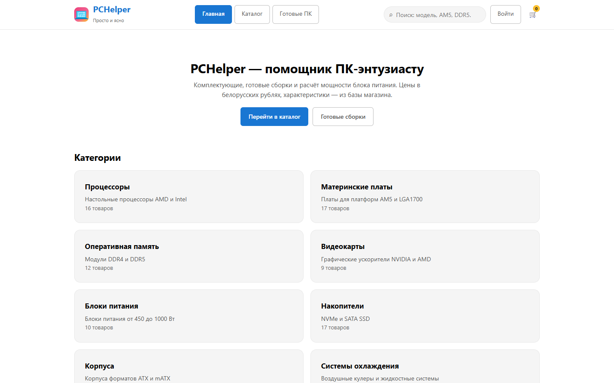

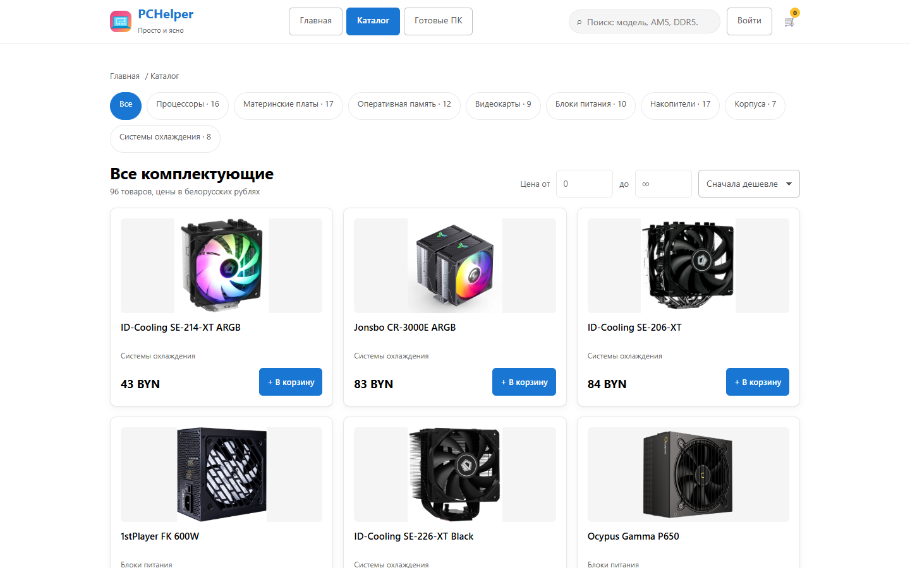

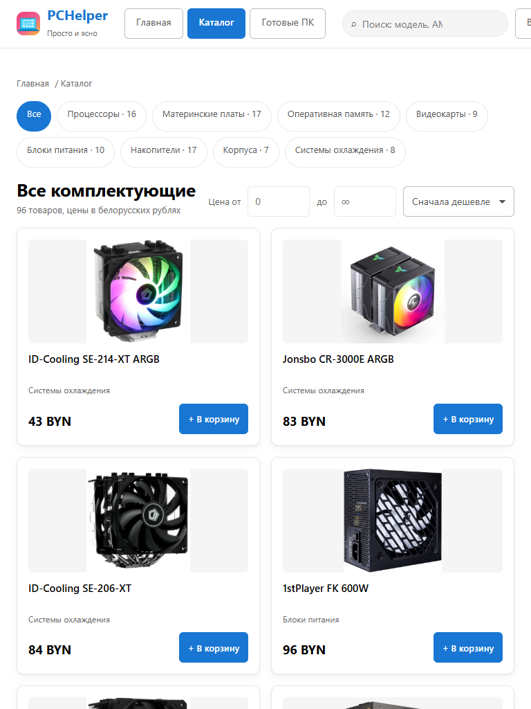

### 5.2. Аутентификация в интерфейсе

Добавлены страницы `/login`, `/register` и защищённый `/profile`. Неавторизованный пользователь перенаправляется на вход, после успешного входа возвращается на запрошенную страницу.

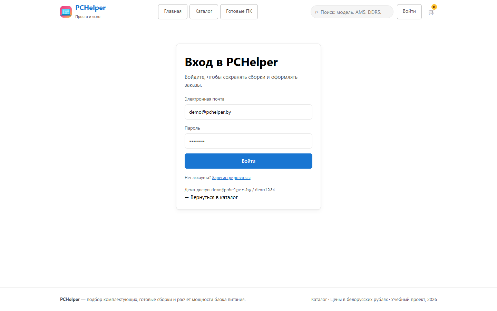

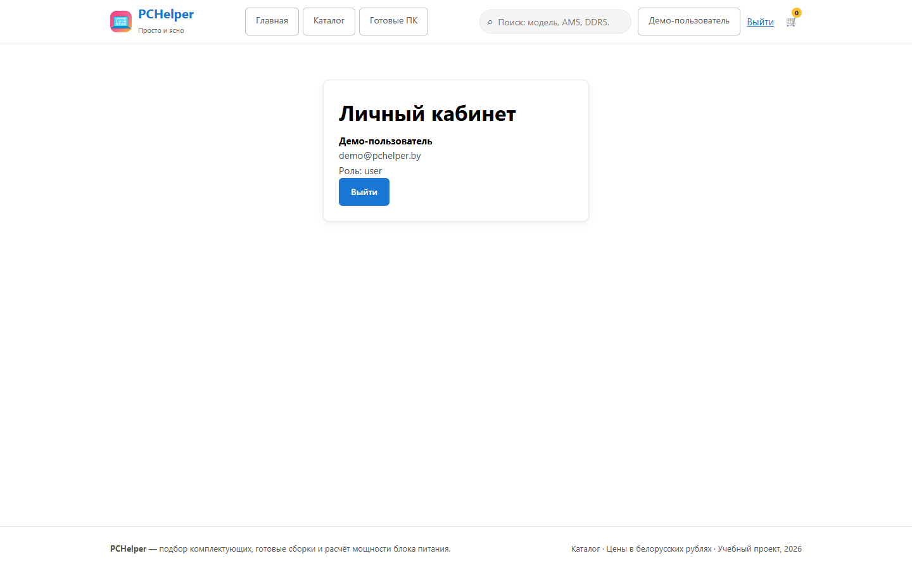

### 5.3. Корзина

Корзина доступна авторизованному пользователю, количество меняется кнопками, сумма пересчитывается.

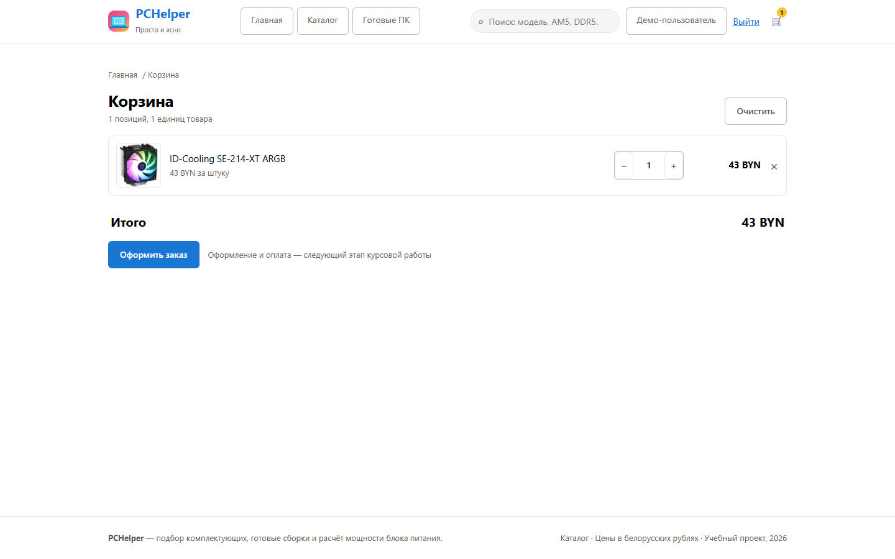

---

## 6. Мобильный клиент (PWA)

Мобильная витрина `frontend/public/mobile.html` работает как PWA:

- `manifest.webmanifest` с иконками 192/512 и maskable;
- `sw.js` с network-first для API и cache-first для статики;
- иконки и `favicon.ico` сделаны из логотипа курсовой 3 курса;
- тач-навигация, нижняя панель, общий с вебом API и корзина.

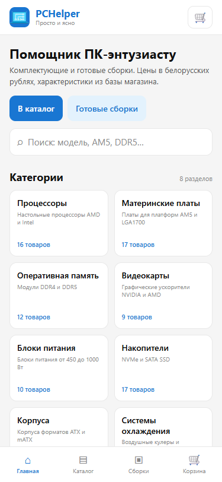

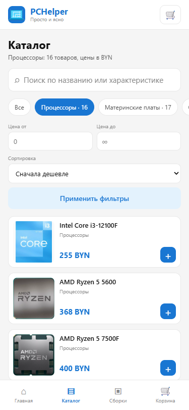

---

## 7. Доступность и качество

Проверено в Lighthouse:

| Метрика | Результат |
|---|---|
| Accessibility | 100 |
| Best Practices | 100 |
| SEO | 100 |

Замечаний нет. Дополнительно:

- контраст второстепенного текста доведен до ≥4.5:1;
- все интерактивные элементы имеют видимый `:focus-visible`;
- поля формы связаны с `label`;
- у изображений есть `alt`;
- заголовки идут по иерархии h1–h3;
- добавлен skip-link «Перейти к содержимому».

---

## 8. Тестирование и CI

- backend: 35 тестов (`node:test`), все проходят;
- UI Playwright: 23 проверки веба, 18 мобильных, 7 проверок авторизации;
- ESLint и Prettier зелёные;
- `vite build` успешно;
- GitHub Actions на `develop` зелёный;
- `main` защищена, `develop` — рабочая ветка команды.

---

## 9. Использование ИИ

При выполнении работы соблюдались три принципа:

1. **Критическая верификация** — весь сгенерированный код проверялся тестами и вручную.
2. **Конфиденциальность** — ключи Supabase и персональные данные не передавались в публичные модели.
3. **Итеративное уточнение** — при некорректном выводе промпт уточнялся.

Документация промптов ведётся в `ПРОМПТ_ДЛЯ_ИИ.txt`. Сгенерированные фрагменты: scaffolding PWA, часть CSS доступности, шаблоны тестов. Все они проверены локально и адаптированы под архитектуру проекта.

---

## 10. Результаты

1. Серверная часть дополнена JWT/сессиями, корзиной и заказами.
2. Веб-клиент получило адаптив и авторизацию.
3. Мобильный клиент работает как PWA.
4. MCP подключён к реальному каталогу Supabase.
5. Lighthouse: 100/100/100.
6. Корзина и заказы хранятся в Supabase, persistence проверена сквозным сценарием.
7. Подготовлены скриншоты и отчёт для защиты.

Следующий этап — ЛР9 (автоматизированное тестирование) и курсовая работа 4 курса.

---

## 11. Доработки прототипов после приёмки ЛР8

По итогам проверки требований ЛР8 мобильный прототип был дополнительно приведён к тому же уровню доступности, что и веб-клиент:

- учтены `env(safe-area-inset-top/bottom)` для iPhone и Android с вырезом;
- тач-цели доведены до 44×44 px (корзина, количество, удаление, кнопки карточек);
- добавлены `:focus-visible`, skip-link и `prefers-reduced-motion`;
- добавлена тёмная тема через `prefers-color-scheme: dark`;
- типографика переведена на `clamp()`, проверено отсутствие горизонтального скролла на 320–1440 px;
- мобильный манифест получил `start_url: /mobile.html`, `id`, `orientation` и `display_override`;
- service worker кэширует `offline.html` и показывает его при отсутствии сети;
- добавлен блок «ИИ-подбор» с инструкцией подключения MCP-агента.

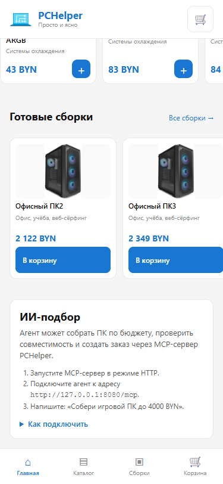

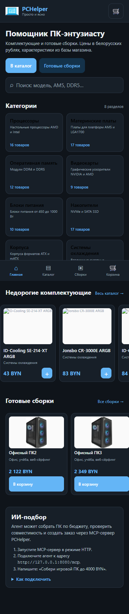

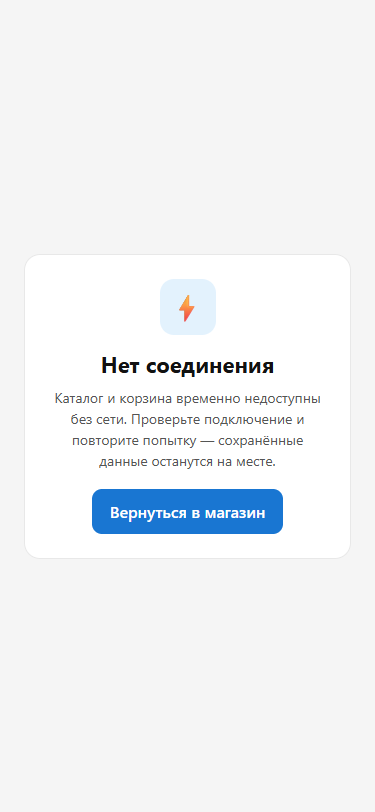

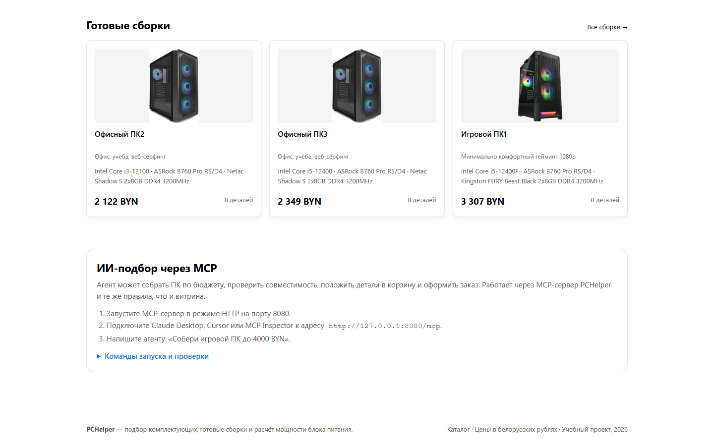

Проверка адаптивности: `scrollWidth` совпадает с `clientWidth` на 320, 375, 768 и 1440 px; размеры интерактивных элементов — не меньше 44×44 px.
