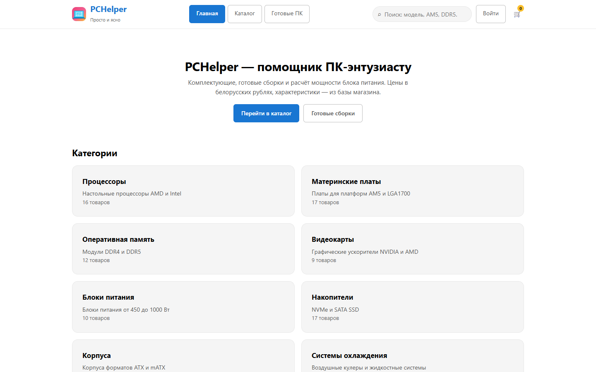
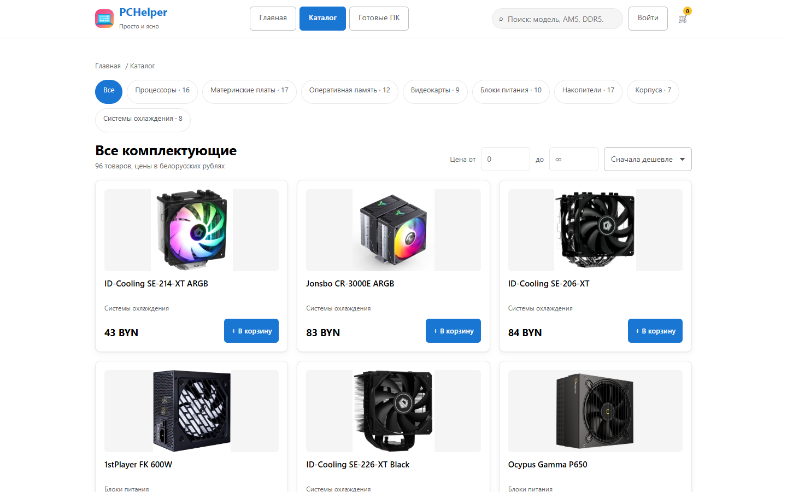
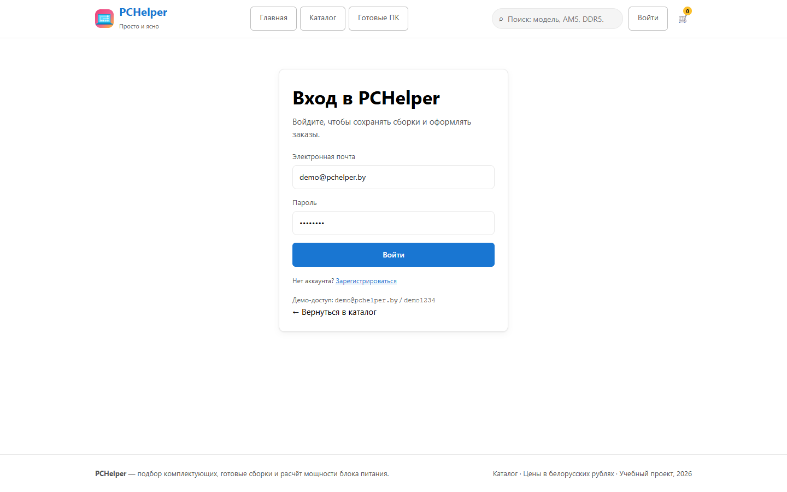
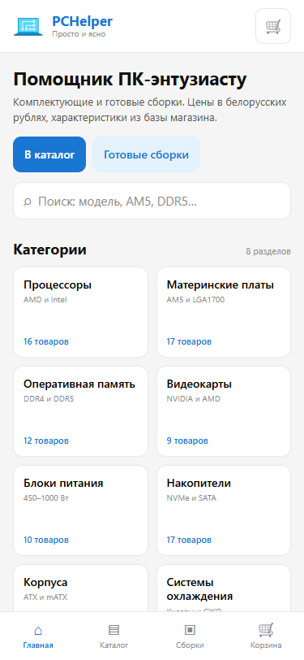
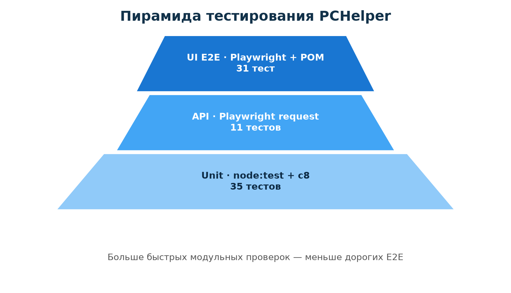
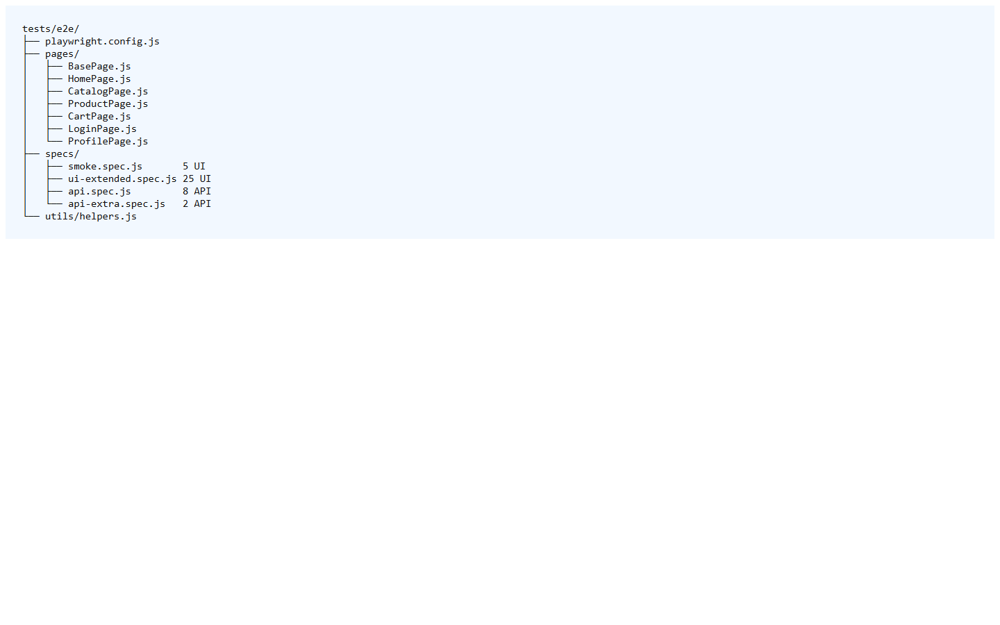
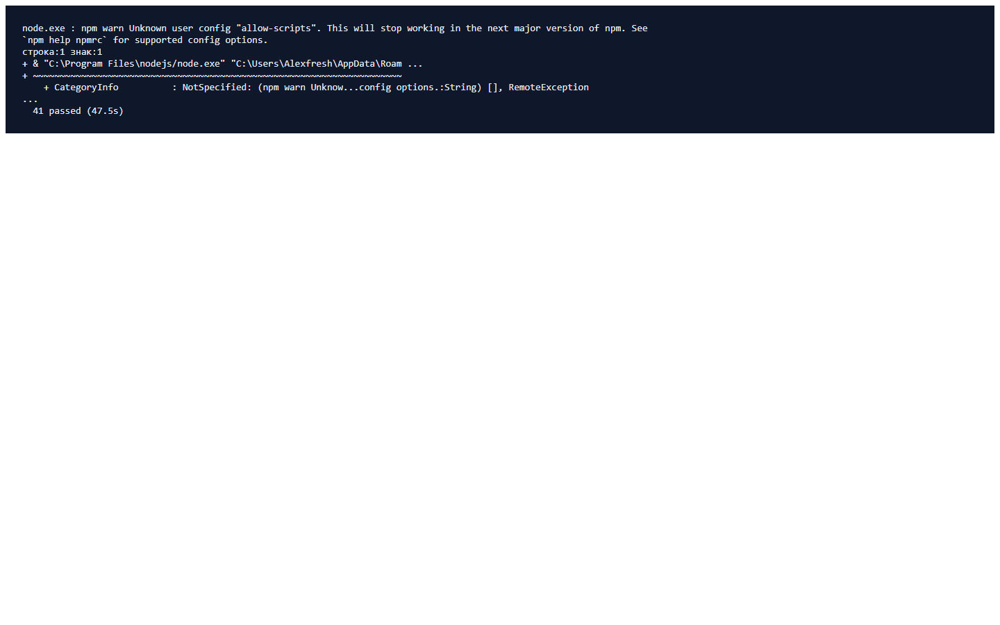
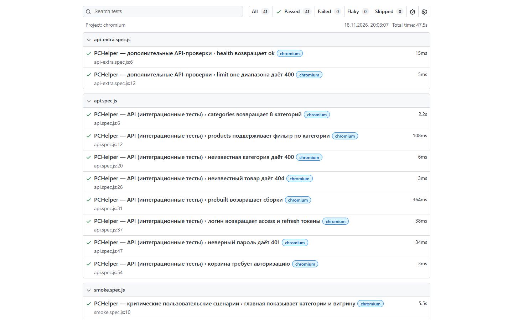

# Лабораторная работа №9

## Автоматизированное тестирование веб-клиента

**Курс:** «Проектирование человеко-машинных интерфейсов»  
**Проект:** PCHelper — интернет-магазин компьютерных комплектующих  
**Команда:** StudentsTrio — Наркевич А. С., Бирюк И. А., Бельский Т. Д.  
**Репозиторий:** https://github.com/AlekseiNarkevich/pchelper-store  
**Ветка:** `pchmi/lr9-final` (от снимка `e78afe7`)  
**Дата:** ноябрь 2026

---

## 1. Цель и задачи

Цель — построить поддерживаемую инфраструктуру автоматизированного тестирования и подтвердить работоспособность PCHelper.

Задачи:

1. Провести тест-анализ и тест-дизайн: тест-план, 20 тест-кейсов, матрица трассируемости.
2. Настроить Playwright и Page Object Model.
3. Реализовать UI- и API-автотесты.
4. Найти и исправить не менее трёх дефектов, закрепить их регрессионными тестами.
5. Подключить HTML-отчёт и CI.
6. Свести метрики, проанализировать нестабильные тесты и готовность к релизу.
7. Описать процесс инжиниринга промптов и вклад участников.

---

## 2. Объект тестирования

Тестируются веб-витрина PCHelper, мобильный PWA-экран, REST API `/api/v1` и сценарии авторизации.









---

## 3. Тест-дизайн

### 3.1. Уровни тестирования

| Уровень | Инструмент | Количество | Что проверяется |
|---|---|---|---|
| Unit | `node:test`, `c8` | 35 | бизнес-логика каталога, корзины, заказов |
| API | Playwright `request` | 11 | статусы, валидация, фильтры, токены |
| UI E2E | Playwright + POM | 31 | критические пользовательские сценарии |
| Доступность | Lighthouse | 100/100/100 | контраст, семантика, PWA |



Пирамида отражает соотношение стоимости и скорости: быстрые модульные проверки составляют основу, API-тесты занимают средний уровень, дорогие UI-сценарии — вершину.

### 3.2. Тест-кейсы и трассируемость

Подготовлено 20 тест-кейсов: позитивные, негативные и граничные. Матрица трассируемости связывает требования (каталог, поиск, карточка, корзина, авторизация, API) с тест-кейсами и автотестами.

Техники тест-дизайна:

- классы эквивалентности — фильтры по цене и категории;
- граничные значения — `limit=1/100/1000`, количество товара 1/10;
- тестирование состояний — пустая и заполненная корзина;
- попарное тестирование — форма регистрации.

### 3.3. Почему Playwright

Выбран Playwright, а не Selenium:

- единый API для UI и API-тестов, не нужен отдельный HTTP-клиент;
- auto-waiting и web-first assertions уменьшают число фиксированных пауз;
- встроенные трассировки, скриншоты и HTML-отчёт;
- проекты и эмуляция устройств позволяют проверять мобильный viewport;
- проще запуск в GitHub Actions: браузеры ставятся одной командой.

Selenium остаётся вариантом для легаси-браузеров, но для React SPA и Chromium-ориентированного CI Playwright даёт меньше инфраструктурного кода.

### 3.4. Тестовые данные и изоляция

- Основной пользователь: `demo@pchelper.by` / `demo1234`.
- Товары и сборки берутся из API, а не из жёстко заданных id: это позволяет работать и на демонстрационной фикстуре, и на реальной базе Supabase.
- Каждый тест создаёт новый `browser context`, поэтому `localStorage`, корзина и cookies не переносятся между сценариями.
- Для API-тестов используется отдельный `request`-контекст; токены получаются в предусловии.
- Переменные окружения: `BASE_URL`, `API_URL`; локально — `http://127.0.0.1:5173` и `http://127.0.0.1:3001`.

---

## 4. Архитектура автотестов (POM)

Используется Page Object Model: логика взаимодействия с элементами вынесена в `pages/`, проверки остаются в тестах.



Page Objects:

- `BasePage` — навигация и ожидания;
- `HomePage`, `CatalogPage`, `ProductPage`, `CartPage`, `LoginPage`, `ProfilePage`.

Принципы:

- семантические локаторы (`getByRole`, `getByLabel`);
- assertions только в тестах;
- авто-ожидания Playwright, фиксированные `sleep` не используются;
- изоляция через новый `browser context` на тест;
- артефакты при падении: скриншот и трассировка.

---

## 5. Результаты прогона





| Метрика | Значение |
|---|---|
| Всего автотестов | 42 |
| UI-автотестов | 31 |
| API-автотестов | 11 |
| Passed | 42 |
| Failed | 0 |
| Skipped | 0 |
| Длительность локально | ~50 с |
| Длительность job E2E в CI | ~3 мин 26 с |
| Покрытие тест-кейсов | 20/20 |

Разница длительности объясняется установкой зависимостей, запуском backend и frontend и публикацией артефактов в CI; локально эти шаги уже выполнены.

API-тесты проверяют статусы 200/400/401/404, валидацию query, фильтры, токены и защиту корзины. Дополнительно добавлен тест визуальной регрессии главной страницы с baseline-скриншотом.

### 5.1. Ссылки на прогоны CI

- Успешный прогон на `e78afe7`:  
  https://github.com/AlekseiNarkevich/pchelper-store/actions/runs/44363226188
- Упавший прогон на `ac47ea3` (до исправления):  
  https://github.com/AlekseiNarkevich/pchelper-store/actions/runs/44359749152

В упавшем прогоне job `E2E (Playwright)` завершился ошибкой; после исправления выбора id товара через API и стабилизации snapshot-пути прогон стал зелёным.

---

## 6. Дефекты и регрессия

| ID | Дефект | Ожидаемо | Фактически | Серьёзность | Приоритет | Статус |
|---|---|---|---|---|---|---|
| LR9-01 | Пустая корзина без `h1` | Заголовок `h1` «Корзина пуста» | Только `div.h2` | Minor | P3 | Исправлено |
| LR9-02 | Устаревшая meta PWA | Есть `mobile-web-app-capable` | Только `apple-mobile-web-app-capable` | Minor | P3 | Исправлено |
| LR9-03 | Авторизованный видел форму входа | Редирект на `/` или профиль | Открывалась форма входа | Major | P1 | Исправлено |

Регрессионные тесты:

| Дефект | Тест |
|---|---|
| LR9-01 | `ui-extended.spec.js` → «LR9-01: пустая корзина имеет h1» |
| LR9-02 | `ui-extended.spec.js` → «LR9-02: PWA meta не устарел» |
| LR9-03 | `ui-extended.spec.js` → «LR9-03: авторизованный не видит форму входа» |

Каждый дефект сначала воспроизводился падающим тестом, после исправления тест стал зелёным. Вложения (скриншоты падений и трассировки) сохраняются в артефактах Playwright.

---

## 7. Нестабильные тесты и стабилизация

В ходе прогонов встречались две категории нестабильности:

1. **Зависимость от данных.** Тест карточки товара использовал жёстко заданный `cpu:1`, которого не было в CI-фикстуре. Исправлено: id берётся через API, тест работает и на фикстуре, и на реальной базе.
2. **Платформо-зависимый путь snapshot.** Визуальная регрессия падала из-за различий в пути к baseline. Исправлено: единый `snapshotPathTemplate`.

Дополнительно:

- вместо `sleep` используются web-first assertions и ожидания по URL/видимости;
- для нестабильных сценариев в CI включены 2 retries, локально — 1;
- при повторе сохраняются trace и скриншот, что позволяет разобрать причину;
- тесты не зависят от порядка выполнения и не делят состояние.

После стабилизации серия из трёх прогонов подряд завершилась без падений.

---

## 8. CI и отчётность

Playwright встроен в GitHub Actions (job `e2e`): запуск на push и pull request, поднятие backend и frontend, установка Chromium, 42 теста и публикация HTML-отчёта артефактом. При падении теста job завершается ненулевым кодом.

Зависимости обновлены: Vite 6.4.6, React Router 7.18.5, ESLint 10, `@eslint/js` 10.0.1, c8 9.1.0. `npm audit` показывает 0 уязвимостей во всех трёх проектах (`backend`, `frontend`, `tests/e2e`). При `npm ci` остаются только два deprecation-предупреждения от `glob@7`/`inflight` внутри c8 — это dev-инструмент покрытия.

SonarQube в текущей конфигурации отключён (`if: false`), вместо него работают ESLint, `npm audit`, unit/API/E2E-тесты и сборка. Для полного соответствия требованию ЛР9 в следующей итерации нужно включить SonarQube или Codacy с токеном репозитория.

---

## 9. Инжиниринг промптов

Использовались три принципа: критическая верификация, конфиденциальность и итеративное уточнение.

### 9.1. Промпт для Page Object

Исходный запрос:

```text
Роль: Senior QA Automation Engineer (Playwright).
Контекст: React SPA, страница входа, поля email/password, кнопка «Войти».
Задача: сгенерировать LoginPage и тест успешного входа.
Ограничения: семантические локаторы, assertions только в тесте, без sleep.
```

Что получилось: первый вариант использовал CSS-селекторы и `waitForTimeout`. После анализа добавлено требование использовать `getByLabel`/`getByRole`, вынести проверки в тест и убрать фиксированные паузы. Финальный вариант проверен запуском.

### 9.2. Промпт для API-тестов

```text
Роль: QA Automation Engineer.
Контекст: REST API /api/v1, эндпоинты /products и /auth/login.
Задача: позитивный и два негативных теста.
Ограничения: не хардкодить id товара, получать данные через API, проверять статус и тело.
```

Первый ответ содержал `cpu:1`; на CI это падало. Промпт уточнён: «получи id через /products, не завись от фикстуры». Финальный тест работает на разных наборах данных.

### 9.3. Промпт для разбора падения CI

```text
Контекст: job E2E упал на тесте карточки товара.
Задача: объяснить причину по логу и предложить минимальное исправление.
Ограничения: не менять бизнес-логику, не отключать тест.
```

Модель указала на отсутствующий `cpu:1` в фикстуре. Исправление проверено локально и в CI; тест остался включённым.

---

## 10. Готовность к релизу

- 42 автотеста, все зелёные; покрытие тест-кейсов 20/20.
- 3 дефекта исправлены и закрыты регрессионными тестами.
- CI запускает линтеры, unit/API/E2E и публикует отчёт.
- Критические сценарии (каталог, корзина, вход, оформление) покрыты.
- Остаточные риски: отключённый SonarQube, зависимость от внешней Supabase и SMTP, отсутствие нагрузочного тестирования.

Продукт готов к демонстрации и защите; для промышленной эксплуатации нужно включить статический анализ и нагрузочные проверки.

---

## 11. Демонстрация на защите

1. Показать мобильный прототип: главная, ИИ-подбор, тёмная тема, offline-страница.
2. Показать веб-витрину и блок «ИИ-подбор через MCP».
3. Запустить `npx playwright test --ui` и один UI-тест.
4. Открыть HTML-отчёт и trace упавшего теста.
5. Показать зелёный и упавший прогоны CI по ссылкам.

---

## 12. Выводы

1. Построена поддерживаемая инфраструктура Playwright + POM.
2. Автоматизировано 42 проверки, все зелёные.
3. Найдено и исправлено 3 дефекта с регрессионными тестами.
4. Матрица трассируемости покрывает все 20 тест-кейсов.
5. `npm audit` — 0 уязвимостей, CI с E2E-прогоном настроен.
6. Подготовлены материалы для демонстрации и дальнейшей защиты.
